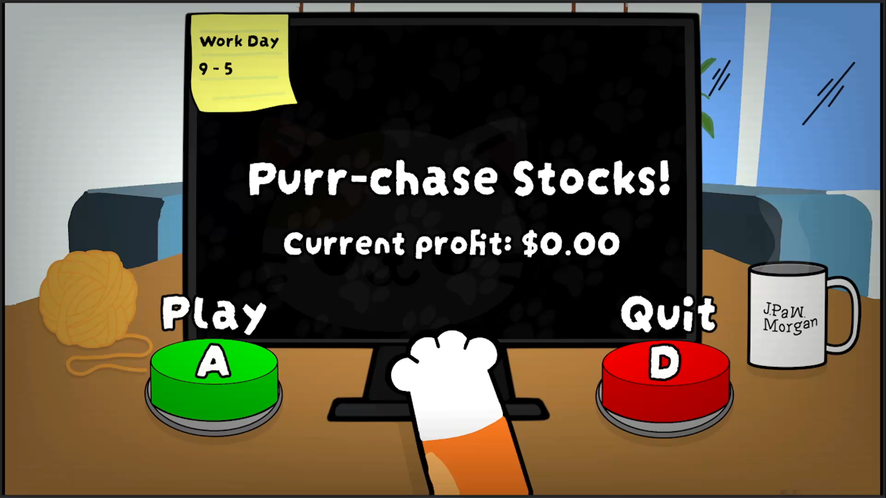

# Purr-chase Stocks!

Purr-chase Stocks! is a stock trading game developed in Godot for the University of Glasgow Tech Society's _Do You Have the Guts? 2026_ hackathon. The game was developed for JPMorgan Chase's challenge: "Make something fun which uses two buttons or actions maximum".

The player controls a cat navigating a volatile stock market, making trading decisions using only Buy and Sell buttons.

## Play the Game
[Play Purr-chase Stocks!](https://bluepandagames.itch.io/purr-chase-stocks)

## Gameplay

The objective is to generate as much profit as possible during a trading day, running from 9 AM to 5 PM. The player can buy and sell stocks while responding to a changing market, where news events can cause prices to rise, spike or crash.

The stock market is driven by a random walk algorithm. This determines how stock prices evolve over time, creating fluctuations that simulate an unpredictable market.

News events add price movements, allowing events to influence the market and create opportunities or risks for the player. The library of events is stored in a JSON file.

## AI usage
The hackathon allowed the use of generative AI for coding and planning. All participants were required to add a short paragraph outlining where, why and how AI was used, alongside an AI usage level from the provided scale.

|     |                             |                                                                                                                                                                     |
| --- | --------------------------- | ------------------------------------------------------------------------------------------------------------------------------------------------------------------- |
| 1   | No AI                       | No AI tools used for code, debugging, design, or content. The team relied on documentation, forums,   and each other.                                            |
| 2   | AI as reference             | AI was used like a tutor or search engine, but all code was written by the team.                                                                                    |
| 3   | AI-assisted                 | The team wrote most of the code by hand, with AI generating some individual pieces.                                                                                 |
| 4   | AI-led, human   directed | AI wrote most of the code, but the team made the technical decisions and gave the AI specific   instructions. The team regularly edited AI output by hand.       |
| 5   | Vibe coded                  | The team described what they wanted and let the AI decide how to build it. Changes were checked   by running the app, and problems were handled by re-prompting. |

Our AI usage was level 3 (AI-assisted). The models used were Claude Opus 4.5 and GPT-5.6 Luna.

The game was an original idea, with all artwork created by hand. Claude was primarily used to assist in developing the random walk algorithm in `stock_market.gd`, which determines stock price movements, and populating `event.json` with a large library of news events to keep the gameplay varied. ChatGPT was also used to quickly generate tween logic for certain animations, helping speed up development. 

AI was primarily used to help team members less familiar with Godot learn the engine and its features. The majority of the code was written by the team.
